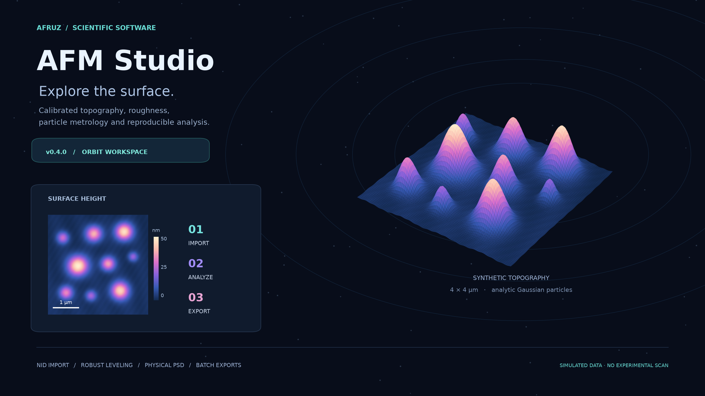
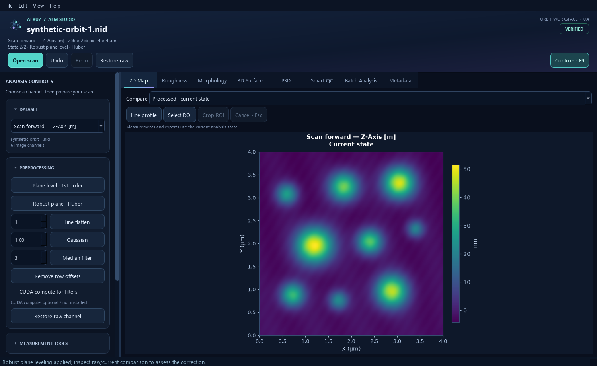
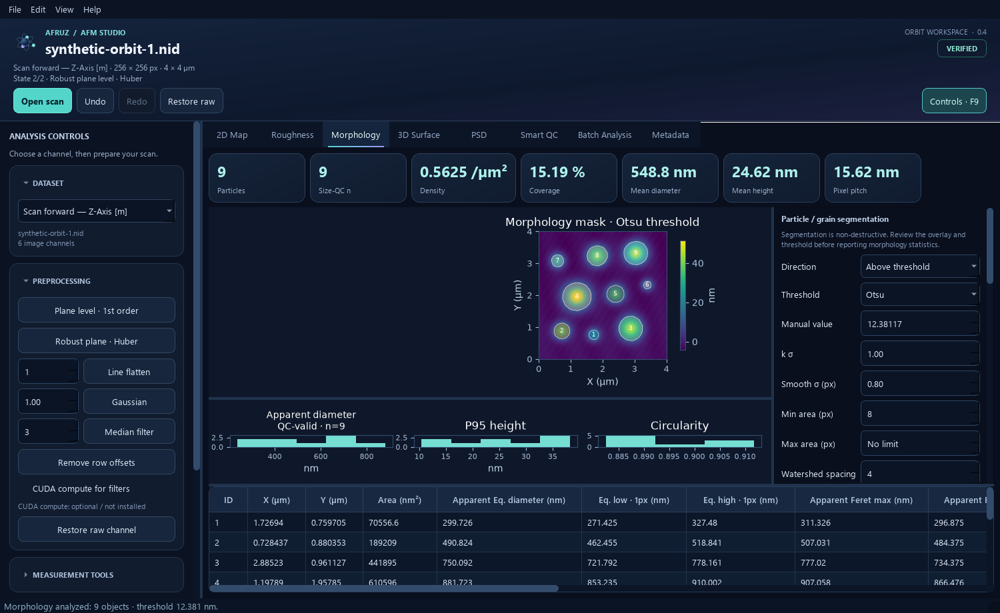

# Afruz AFM Studio

**v0.4.0 · Orbit workspace**

[](https://doi.org/10.5281/zenodo.23348914)

A Python desktop workspace for calibrated atomic force microscopy analysis:
Nanosurf NID import, topography preparation, roughness, particle metrology,
quality diagnostics, interactive 3D surfaces, and reproducible batch exports.



The cover and loaded-workspace screenshots use analytically generated synthetic
surfaces. No experimental scans or images derived from them are published here.

## Install and run

Use Python 3.10+. On Windows, run:

```bat
install_windows.bat
run_windows.bat
```

The installer creates a project-local virtual environment. For an existing
Python environment:

```bash
python -m pip install -r requirements.txt
python afm_studio.py
```

Optional NVIDIA CUDA filtering uses `requirements-gpu.txt` or
`install_gpu_rtx40.bat`. OpenGL rendering works independently of CuPy;
particle segmentation and batch recipes run on the CPU.

## Try it with synthetic data

Create two demo NID files locally, then open one in the application:

```bash
python examples/synthetic_afm.py --output demo --points 256
```

These six-channel fixtures contain a mathematical substrate and Gaussian particles,
with forward/backward height and deflection channels. They exercise the supported
NID reader layout; they do not model every instrument behavior or NID variant.
Generated NID files are ignored by Git.



## Prepare, measure, export

1. Open or drop a NID scan; inspect its channel, lateral ranges and calibration badge.
2. Prepare the surface with plane/Huber leveling, row correction or filtering.
   Compare processed, raw and difference views, and undo or redo operations.
3. Inspect roughness, profiles, ROI crops, PSD, ACF and Smart QC diagnostics.
4. Segment particles and visually inspect the mask and selected statistics population.
5. Export results or drop multiple scans into a background batch with an ordered recipe.



| Export | Contents |
|---|---|
| Particle CSV | Complete particle table, calibrated geometry, height, volume and QC flags |
| Morphology Excel | Summary, particles, selected-population size statistics and tidy distributions |
| Morphology figure | 600 DPI mask, apparent diameter, P95 height and circularity plots |
| Analysis JSON | Metrics, processing history, crop, algorithm version and exact source SHA-256 |
| Batch Excel | Scan results and the immutable protocol captured at the start of the run |

Analysis history is kept in memory for the active channel. JSON describes the
analysis; it is not a restorable session.

## New in v0.4.0

- Midnight/cyan/violet interface, orbital welcome visuals, animated collapsible
  controls and tab indicators. **View → Reduce motion** or
  `AFRUZ_REDUCED_MOTION=1` settles transitions and stops decorative timers.
- Responsive batch processing in a Qt worker. Cancellation finishes the current
  scan, preserves completed results and unlocks the queue. Closing safely waits
  for the current scan, then closes automatically.
- Huber robust plane leveling, physically normalized 2D PSD, exact local Sa,
  and linear, overlap-normalized autocorrelation.
- Missing-data-aware filters and measurements, robust morphology backgrounds,
  calibrated anisotropic watershed spacing and boundary/sampling QC.
- Strict batch channel/unit checks, versioned provenance and standard JSON
  `null` values for non-finite metrics.

See [CHANGELOG.md](CHANGELOG.md) for release history. Corrected algorithms can
change PSD amplitudes, local Sa, ACF lengths and particle height/volume compared
with v0.3.8; record the algorithm version when comparing analyses.

## Scientific conventions

Internal topography retains its NID signal unit; lateral dimensions use SI
calibration. Pixel pitch is field width divided by raster count. The calibration
badge checks agreement between header fields, not an external instrument certificate.

Huber fitting down-weights large residuals but cannot distinguish broad specimen
features from unwanted background. Inspect the raw/current comparison. Local
background fitting falls back to a median for sparse or degenerate rings.

The 2D PSD uses:

```text
PSD = dx * dy * |FFT((z - plane) * window)|² / sum(window²)
```

Its integral across both frequency axes equals the window-weighted residual
variance. Radial values are annular means of a 2D density, with units of
signal² × lateral-unit²; they are not a 1D radial density.

Lateral particle dimensions remain **apparent AFM sizes**. Sampling QC uses
equivalent diameter divided by the coarser X/Y pixel pitch, with a default
minimum of three pixels across. Under-resolved particles stay in the complete
table and are flagged. This does not correct probe-tip convolution or establish
formal uncertainty. Smart QC and segmentation suggestions are deterministic
heuristics; the advisor's confidence label is not a calibrated probability.

Method references: [SciPy periodogram scaling](https://docs.scipy.org/doc/scipy/reference/generated/scipy.signal.periodogram.html),
[Gwyddion statistical analysis](https://www.gwyddion.net/documentation/user-guide-en/statistical-analysis.html),
and [Qt threads and GUI objects](https://doc.qt.io/qtforpython-6/overviews/qtdoc-threads-qobject.html).

## Keyboard shortcuts

| Shortcut | Action |
|---|---|
| Ctrl+O | Open NID scan |
| Ctrl+Z | Undo |
| Ctrl+Shift+Z / Ctrl+Y | Redo |
| Ctrl+R | Restore the full raw channel |
| Esc | Cancel profile or ROI selection |
| F9 | Show or hide controls |

## Tests and validation

With dependencies installed:

```bash
python -m unittest discover -s tests -v
```

The suite creates two synthetic NID fixtures in a temporary directory by default.
For an optional local check against your own scans, set `AFRUZ_AFM_SAMPLE_DIR`
to a directory containing at least two NID files.

The release passed **34 tests**. See [validation details](docs/VALIDATION.md)
for known-answer scientific checks, GUI coverage and hardware limits.

To regenerate the cover:

```bash
python examples/render_github_preview.py
```

## Archive and citation

The **v0.4.0** release is archived on [Zenodo](https://doi.org/10.5281/zenodo.23348914).
Use its version DOI to identify the exact software release used in your analysis:

> AliAfruz. (2026). *Afruz AFM Studio: Orbit Workspace* (v0.4.0) [Software]. Zenodo. https://doi.org/10.5281/zenodo.23348914

- **Version DOI (v0.4.0):** [10.5281/zenodo.23348914](https://doi.org/10.5281/zenodo.23348914)
- **All versions DOI:** [10.5281/zenodo.23348913](https://doi.org/10.5281/zenodo.23348913)

GitHub's **Cite this repository** entry uses [CITATION.cff](CITATION.cff).
For BibTeX:

```bibtex
@software{aliafruz_afm_studio_2026,
  author    = {{AliAfruz}},
  title     = {Afruz AFM Studio: Orbit Workspace},
  version   = {v0.4.0},
  date      = {2026-10-13},
  year      = {2026},
  publisher = {Zenodo},
  doi       = {10.5281/zenodo.23348914},
  url       = {https://doi.org/10.5281/zenodo.23348914}
}
```
